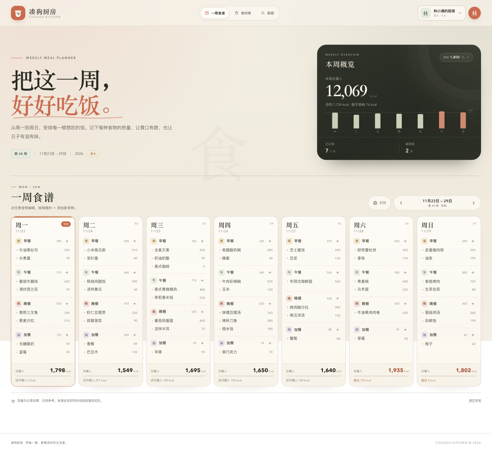
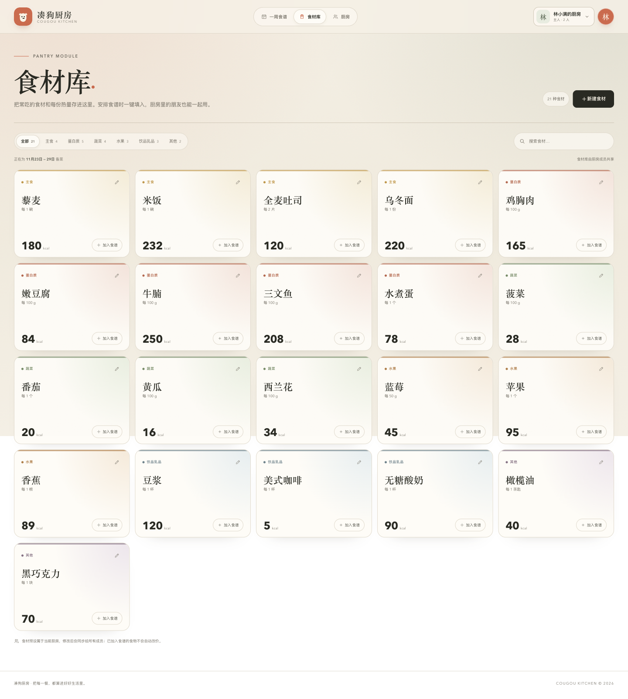
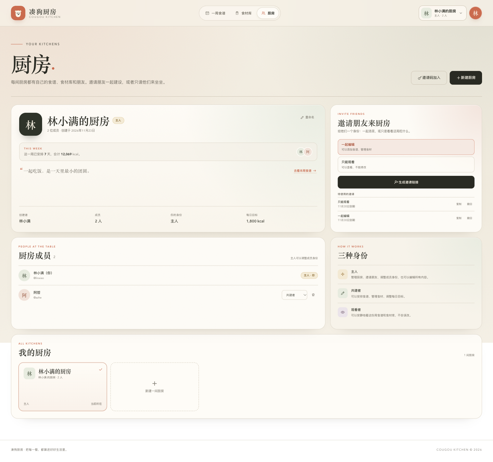
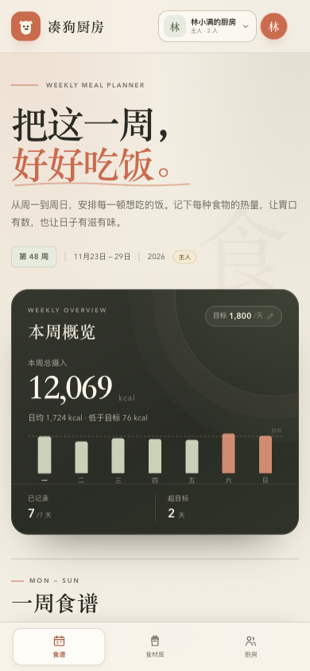
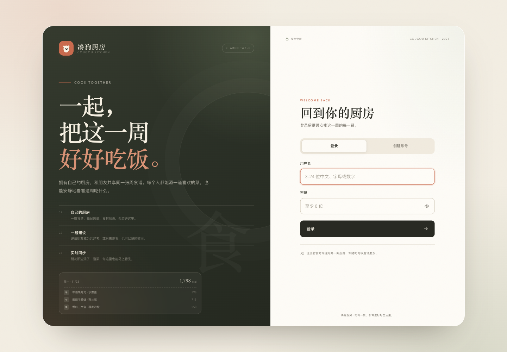
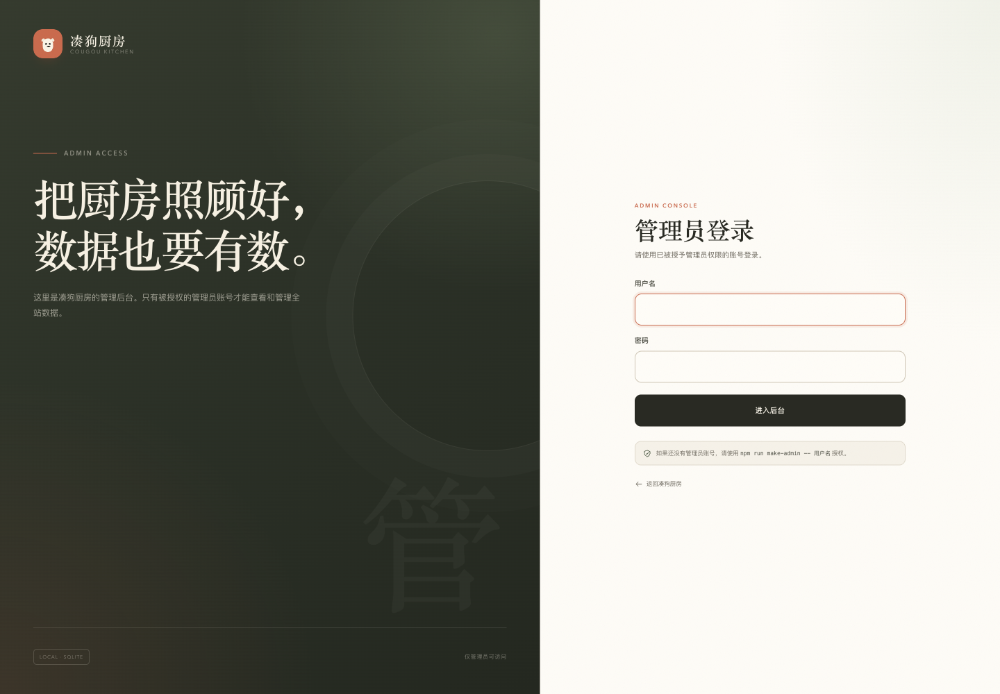

# 凑狗厨房 · 一起好好吃饭

一个可以多人共享的一周食谱网站：拥有自己的 kitchen、邀请朋友一起编辑或观看、维护厨房共享的食材预设，并实时同步彼此的改动；附带一个仅管理员可访问的数据后台。



## 功能

### 一周食谱

- 周一到周日独立安排早餐、午餐、晚餐、加餐。
- 每种食物都可以填写名称和热量，自动计算每餐小计、每日总热量、每周总摄入与日均值。
- 每日热量目标由整个厨房共享，成员修改后所有人的进度条、超标提示都会同步。
- 支持切换上一周 / 下一周、回到本周、打印本周。
- 首次注册的厨房会附带一份可编辑的示例周食谱。

### 食材库（独立模块）

- 顶栏「食材库」是一个独立页面，用来维护厨房共享的食材预设。
- 每种预设包含名称、分类、每份份量、每份热量。
- 支持分类筛选、搜索、编辑和删除。
- 添加食物时可以直接从食材库选择预设，名称和热量会自动填入。
- 食材卡片可以快速「加入食谱」，选择本周的某一天和某一餐。

### 登录与账号

- 用户名 + 密码注册 / 登录，密码使用 Node.js `scrypt` 加盐哈希保存。
- 登录状态通过 HttpOnly、SameSite=Lax 的会话 Cookie 保持 30 天。
- 注册后自动创建第一间厨房，之后可以继续新建多间厨房。
- 顶栏可以快速切换厨房，也可以从邀请链接或邀请码加入朋友的厨房。
- 头像菜单 →「账号设置」可以修改昵称和密码。修改密码需要验证当前密码，并会撤销其他设备上的登录会话。

### 共享厨房

- 每位用户都可以新建自己的厨房，并邀请朋友。
- 三种身份，服务端强制校验：
  - **主人**：邀请朋友、管理成员、重命名厨房、编辑所有内容。
  - **共建者**：编辑周食谱、管理食材库、修改每日目标。
  - **观看者**：只能查看食谱、食材库和成员列表。
- 邀请链接默认 7 天有效，可邀请多人，可随时复制或撤回。
- 通过 Server-Sent Events 实时同步：朋友添加食物、修改食材或成员身份后，你这边会自动刷新。
- 所有修改都先经过服务端权限校验，前端隐藏按钮只是体验层。

### 管理后台

- 独立页面：`/admin`，只有 `is_admin = 1` 的账号才能读取后台数据。
- 概览：用户、管理员、厨房、食材、食谱、有效邀请、活跃会话的实时统计。
- 用户管理：查看全部用户，授予 / 取消管理员权限，删除用户。
- 厨房管理：查看每间厨房的成员、食材、最近食谱记录，删除整间厨房。
- 邀请管理：查看全站邀请状态，撤回仍有效的邀请。
- 会话管理：查看活跃登录会话并撤销。
- 安全约束：不能修改自己的管理员身份，不能删除自己，系统至少保留一位管理员。

## 运行

需要 **Node.js >= 24**（使用内置 `node:sqlite`，不需要安装任何 npm 依赖）。

```bash
cd "凑狗厨房"
npm start
```

然后打开：

<http://127.0.0.1:4174>

首次打开会进入登录页。点击「创建账号」注册，就会得到一间带示例食谱的厨房。

> **不要直接双击 `index.html`。** 这是一个带登录和多人协作的全栈应用，必须通过 Node 服务访问；直接打开 HTML 文件无法使用登录、厨房和共享数据。
>
> macOS 用户也可以直接双击项目里的 **`启动厨房.command`**，它会自动启动服务并打开浏览器。

### 局域网内邀请朋友试用

默认只监听本机。若朋友和你在同一个局域网，可以用：

```bash
HOST=0.0.0.0 PORT=4174 npm start
```

然后通过这台电脑的局域网 IP 访问，例如 `http://192.168.1.10:4174`。邀请链接会按当前访问地址生成。

> 正式部署到公网时，请放在 HTTPS 反向代理之后，并确认反向代理传递 `X-Forwarded-Proto: https`，这样会话 Cookie 会自动加上 `Secure`。

### 部署

项目已经包含 `Dockerfile`、`railway.json` 和详细的 [DEPLOY.md](DEPLOY.md)。推荐使用带持久卷的 Railway 免费计划；Render 免费 Web Service 没有持久磁盘，SQLite 会在重启后丢失。

部署时必须：

1. 设置 `HOST=0.0.0.0`（Docker 镜像已内置）；
2. 给服务挂载持久卷到 `/app/data`；
3. 设置 `ADMIN_USERNAME=你的用户名`，让首个管理员自动生效。

### 管理员设置

管理员账号不通过公开注册获得，需要显式授权。两种方式：

```bash
# 方式一：把已经注册的用户提升为管理员
npm run make-admin -- 用户名

# 方式二：启动时通过环境变量指定（该用户注册后会自动成为管理员）
ADMIN_USERNAME=用户名 npm start
```

授权后打开：

<http://127.0.0.1:4174/admin>

管理后台使用同一个账号体系。只有管理员能读取后台数据；不是管理员的账号即使打开 `/admin`，也只会看到「没有管理权限」。

## 首次使用流程

1. 注册账号，系统自动创建你的第一间厨房。
2. 在「一周食谱」里点击每餐右侧的 `＋` 添加食物。
3. 在「食材库」里维护常吃食材，之后添加食物时直接选择预设。
4. 打开「厨房」，选择「一起编辑」或「只能观看」，生成邀请链接发给朋友。
5. 朋友打开链接，登录或注册后会自动加入这间厨房。
6. 主人可以在「厨房」页面调整成员身份、移除成员或撤回邀请。
7. 如需管理全站数据，用 `npm run make-admin -- 用户名` 授权管理员，再访问 `/admin`。

## 数据与安全

- 数据库：`data/cougou.sqlite`（SQLite，首次运行时自动创建）。
- 密码不会明文保存；会话只保存 token 的 SHA-256 哈希。
- 所有写接口要求同源请求和自定义请求头，降低 CSRF 风险。
- 邀请码是随机 bearer token，只保存在数据库中；主人可以随时撤回。
- 管理后台 API 每次请求都会检查当前会话的 `is_admin` 标记，非管理员一律 403。
- 删除 `data/` 目录会清空所有账号、厨房和食谱记录。请自行做好备份。
- 本项目是自托管的小型应用，不包含邮箱验证、找回密码、第三方登录或审计日志；公网使用时请根据实际需求补充。

## 文件结构

```text
.
├── server.js               # Node HTTP 服务、SQLite、认证、权限、邀请、SSE
├── index.html              # 登录页、应用界面与全部弹层
├── styles.css              # 视觉系统、响应式与打印样式
├── app.js                  # 前端状态、路由、API 调用与实时同步
├── admin.html              # 管理后台页面
├── admin.css               # 管理后台视觉与响应式样式
├── admin.js                # 管理后台数据、操作与权限门禁
├── scripts/make-admin.js   # 管理员授权 CLI
├── package.json
├── Dockerfile              # 容器部署
├── railway.json            # Railway 部署配置
├── DEPLOY.md               # 免费平台部署指南
├── 启动厨房.command        # macOS 双击启动器
├── README.md
├── preview-auth.png
├── preview-desktop.png
├── preview-mobile.png
├── preview-ingredients.png
├── preview-kitchen.png
├── preview-admin.png
└── data/                   # 运行时生成的 SQLite 数据（不提交）
```

## 常用命令

```bash
npm start                       # 启动服务
PORT=5000 npm start
HOST=0.0.0.0 npm start
npm run make-admin -- 用户名     # 授权管理员
```

## 页面预览

| 食材库 | 厨房 |
| --- | --- |
|  |  |

移动端：



登录页与后台：

| 登录页 | 管理后台 |
| --- | --- |
|  |  |
